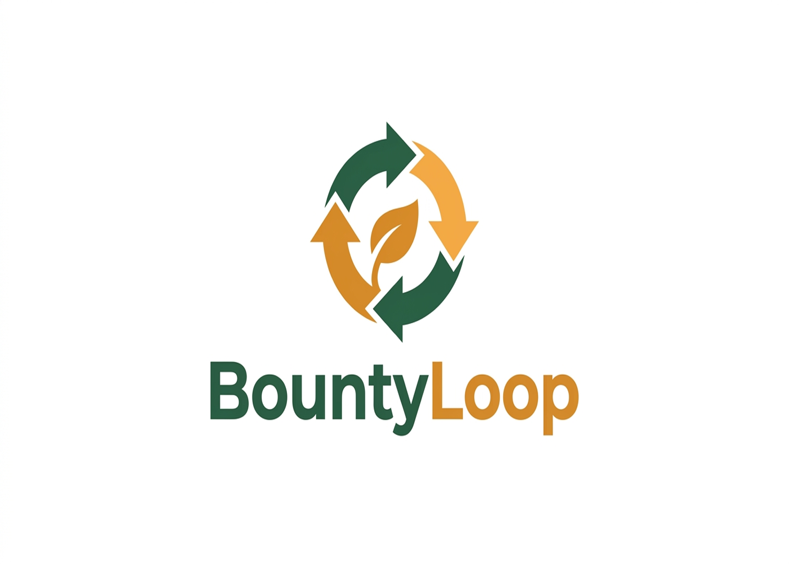

# BountyLoop

> **Turn surplus into supper — the AI loop that keeps good food in the community.**



---

## What is BountyLoop?

BountyLoop is an AI-powered food rescue and redistribution platform. It uses computer vision and machine learning to detect surplus and near-expiry food *at the source*, then uses an agent layer built on the Model Context Protocol (MCP) to orchestrate redistribution to charities, food banks and discounted-market buyers in real time.

**The problem.** Roughly one third of all food produced — about 1.3 billion tonnes a year — is lost or wasted while hundreds of millions of people face hunger. The bottleneck is not production; it is matching surplus food to people fast enough, before it spoils.

**Why the name.** "Waste" is a negative framing; "bounty" is abundance. The "loop" is the circular economy — keeping that abundance circulating inside the local community instead of ending in a landfill.

---

## How it works

1. A donor photographs surplus food in the mobile app.
2. A CV pipeline classifies the item and grades freshness; hazardous cases go to human review.
3. A donation record is created and an LLM orchestrator agent runs the matching loop.
4. The best recipient is found, a route is computed, and push/SMS notifications fire.
5. Pickup is confirmed; impact is logged (kg rescued, meals equivalent, CO₂e avoided).

See [docs/architecture.md](docs/architecture.md) for the full system diagram.

---

## Quickstart (local development)

### Prerequisites

- Docker + Docker Compose
- Python 3.12
- Node 22+
- Flutter (stable) — required for Phase 6+
- `make`

### 1. Clone and configure

```bash
git clone https://github.com/your-org/bountyloop.git
cd bountyloop
cp .env.example .env
# Edit .env — at minimum, keep the defaults for local dev
```

### 2. Start the stack

```bash
make up
# docker compose up --build -d
```

### 3. Verify health

```bash
make health
# → API: {"status":"ok","version":"0.1.0","env":"development"}
# → CV:  {"status":"ok","version":"0.1.0","env":"development","models_loaded":{}}
```

### 4. Check PostGIS

```bash
docker compose exec db psql -U bountyloop -c "SELECT postgis_version();"
# → 3.4.x ...
```

### 5. Run tests

```bash
make test
```

---

## Project structure

```
bountyloop/
├── backend/          FastAPI API (REST + WebSocket)
├── cv_service/       ONNX inference microservice
├── ml/               Training notebooks + data scripts + artefacts
├── mcp_servers/      LLM agent MCP server deployables
├── mobile/           Flutter donor + recipient app
├── dashboard/        React + Vite + TypeScript web dashboard
├── infra/            Render, Vercel, Neon, OSRM configuration
├── assets/brand/     Logo + brand guide
└── docs/             Architecture, schema, API, models, progress
```

---

## Development phases

| Phase | Objective | Status |
|---|---|---|
| 0 | Foundation, monorepo, Docker, /healthz | ✅ In Progress |
| 1 | DB schema + PostGIS migrations | 🔜 |
| 2 | Firebase auth + role guards | 🔜 |
| 3 | CV baseline (EfficientNet-B0 freshness, ONNX) | 🔜 |
| 4 | Item classifier + 4-level freshness + hazard cascade | 🔜 |
| 5 | Donation API (photo-to-donate) | 🔜 |
| 6 | Flutter app (donor + recipient + push) | 🔜 |
| 7 | Matching engine + routing + map | 🔜 |
| 8 | React operator dashboard | 🔜 |
| 9 | MCP servers + LLM orchestrator | 🔜 |
| 10 | Impact measurement + methodology | 🔜 |
| 11 | Surplus forecasting (SARIMAX/LightGBM) | 🔜 |
| 12 | Hardening, offline, privacy, observability | 🔜 |
| 13 | Deployment + CI/CD | 🔜 |
| 14 | Pilot + evaluation + retraining | 🔜 |

---

## Brand

- **Brand green:** `#2D5A3D` (forest green)
- **Brand amber:** `#D98E32` (golden amber)
- See [assets/brand/brand.md](assets/brand/brand.md) for full usage guide.

---

## Licence

Research/pilot use. See dataset licence notes in [docs/datasets.md](docs/datasets.md) before any commercial use.

Attribution: map data © OpenStreetMap contributors.

---

## Non-goals (v1)

- No payments
- No cold-chain logistics
- No multi-city scale
- The hazard flag is a **safety gate only** — never a claim of laboratory-grade contamination detection
