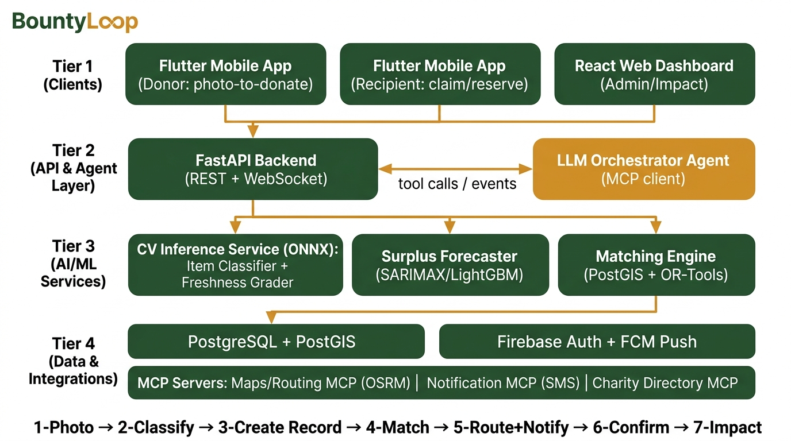

# BountyLoop — Architecture

> **Turn surplus into supper — the AI loop that keeps good food in the community.**

## System Overview



## Four Tiers

### Tier 1 — Clients
- **Flutter Mobile App (Donor):** camera → classify → donate in 3 taps
- **Flutter Mobile App (Recipient):** browse offers → claim → confirm pickup
- **React Web Dashboard:** operator live feed, human review queue, impact charts

### Tier 2 — API & Agent Layer
- **FastAPI Backend** (REST + WebSocket): donation lifecycle, auth, matching orchestration
- **LLM Orchestrator Agent** (MCP client): runs the detect→match→route→notify→confirm loop autonomously

### Tier 3 — AI/ML Services
- **CV Inference Service** (ONNX Runtime): Item Classifier (12 rescue categories) + Freshness Grader (binary → 4-level) + Hazard Detector
- **Surplus Forecaster** (SARIMAX/LightGBM): predicts when a donor will have surplus
- **Matching Engine** (PostGIS + OR-Tools): ranks recipients by distance, urgency, capacity, need, reliability

### Tier 4 — Data & Integrations
- **PostgreSQL 16 + PostGIS 3.4:** donations, donors, recipients, claims, impact log, agent events
- **Firebase Auth + FCM:** authentication + push notifications (primary channel)
- **MCP Servers:** Maps/Routing (OSRM), Notification (SMS, push-first), Charity Directory

## Donation Lifecycle (7 steps)

```
1. Photo uploaded (donor mobile app)
2. Item + freshness classified (CV service cascade)
3. Donation record created (FastAPI + PostgreSQL)
4. Agent matches best recipient (LLM orchestrator + PostGIS + OR-Tools)
5. Route + SMS/push dispatched (OSRM + FCM + Twilio)
6. Pickup confirmed (recipient mobile app)
7. Impact metrics logged (kg rescued, meals, CO₂e avoided)
```

## CV Cascade (confidence gates)

```
photo → EXIF strip → Item classifier → Freshness head → Hazard head
  ├─ item_conf ≥ 0.90 AND freshness_conf ≥ 0.90 AND hazard=none → AUTO CREATE
  ├─ 0.60 ≤ conf < 0.90 AND hazard=none                          → ASK DONOR CONFIRM
  └─ conf < 0.60 OR hazard ≠ none                                → HUMAN REVIEW QUEUE
```

## Technology Stack

| Layer | Decision |
|---|---|
| Backend API | FastAPI (Python 3.12), Pydantic v2, SQLAlchemy 2.0, GeoAlchemy2, Alembic |
| CV inference | Separate FastAPI microservice, ONNX Runtime (CPU) |
| ML training | PyTorch + timm (EfficientNet-B0/B3), scikit-learn, statsmodels, LightGBM |
| Optimisation | Google OR-Tools (CVRP-lite) |
| Database | PostgreSQL 16 + PostGIS 3.4 |
| Mobile | Flutter (Riverpod, go_router, flutter_map/OSM, FCM) |
| Web dashboard | React + Vite + TypeScript + TanStack Query + MapLibre |
| Auth & push | Firebase Auth + FCM |
| SMS | Twilio (push-first, hard daily cap) |
| Routing | Self-hosted OSRM on city OSM extract |
| Hosting | Render (API + CV + MCP), Vercel (dashboard), Neon (DB) |
| Agent layer | Python MCP SDK + cheapest LLM tier |

## Key Design Boundaries

- `cv_service/` is independent — if it crashes, the API still accepts manual donations
- `mcp_servers/` are separate deployables — one crash doesn't cascade
- `ml/` stays notebook-first — only `.onnx` + `metrics.json` cross into serving
- `ml/data/custom/` is git-ignored and privacy-bound — photos never committed
- The dashboard never touches PostGIS directly — all via the versioned `/v1` API
