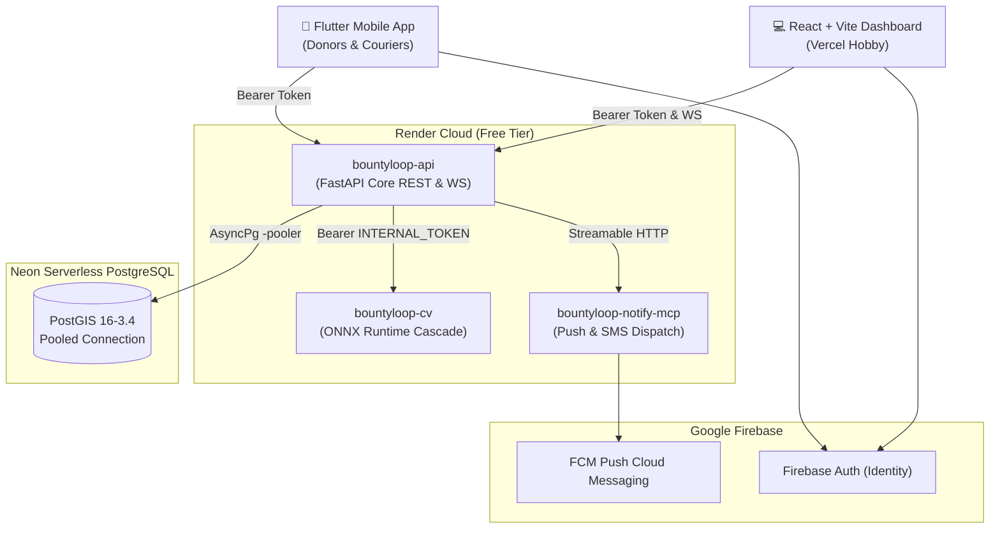

# BountyLoop — Production Deployment & CI/CD Guide (Phase 13)

> **Objective:** Zero-dollar ($0/month) production deployment across free-tier providers with automated CI/CD pipelines, reproducible from a clean clone.
> **Verified Provider Limits as of November 2026:** Neon Free (~0.5 GB, scale-to-zero), Render Free (750 hrs, 512 MB RAM), Vercel Hobby (~100 GB bandwidth), Firebase Spark (~50k MAU).

---

## 1. System Topology & Service Architecture



---

## 2. Step 1: Database Provisioning (Neon Serverless PostgreSQL + PostGIS)

### 2.1 Project Creation & Extension Activation
1. Sign up at [neon.tech](https://neon.tech) and click **Create Project**.
2. **Project Name:** `bountyloop-prod`
3. **PostgreSQL Version:** 16
4. **Cloud Region:** `US East (Ohio)` or `US West (Oregon)` (match Render region).
5. Open the Neon **SQL Editor** in the dashboard and enable PostGIS:
   ```sql
   CREATE EXTENSION IF NOT EXISTS postgis;
   SELECT PostGIS_Version();
   ```

### 2.2 Connection String & Scale-to-Zero Realities
1. In the Neon Dashboard, toggle **Connection Pooling** on.
2. Neon provides a pooled hostname containing `-pooler` (e.g. `ep-quiet-grass-123456-pooler.us-east-1.aws.neon.tech`).
3. Prepare the two required connection strings:
   - **Async Driver (`DATABASE_URL`):**
     `postgresql+asyncpg://<user>:<password>@<neon-pooler-host>/bountyloop_prod?ssl=require`
   - **Sync Driver (`DATABASE_URL_SYNC`):**
     `postgresql+psycopg://<user>:<password>@<neon-pooler-host>/bountyloop_prod?ssl=require`

> [!NOTE] Scale-to-Zero Latency
> Neon free tier suspends compute after 5 minutes of inactivity. The first query after idle experiences an initialization cold start of **1.0–2.5 seconds**. Subsequent queries execute in sub-15ms. BountyLoop's database connection pool parameters (`pool_size=5`, `max_overflow=10`, `pool_pre_ping=True`) automatically withstand this idle resumption without dropped connections.

### 2.3 Run Database Migrations
From your local terminal with the Neon connection string:
```bash
# Set environment variable temporarily
export DATABASE_URL="postgresql+asyncpg://<user>:<password>@<neon-pooler-host>/bountyloop_prod?ssl=require"
export DATABASE_URL_SYNC="postgresql+psycopg://<user>:<password>@<neon-pooler-host>/bountyloop_prod?ssl=require"

# Apply all Alembic migrations up to head
alembic upgrade head
```

---

## 3. Step 2: Render Multi-Service Deployment (`infra/render.yaml`)

Render orchestrates the backend, computer vision service, and notification dispatch using the blueprint specification in `infra/render.yaml`.

### 3.1 Import Blueprint Click-Path
1. Navigate to [dashboard.render.com](https://dashboard.render.com).
2. Click **New +** > **Blueprint**.
3. Connect your BountyLoop GitHub repository.
4. Render detects `infra/render.yaml` automatically and creates:
   - `bountyloop-api` (Docker web service)
   - `bountyloop-cv` (Docker web service with baked ONNX artifacts)
   - `bountyloop-notify-mcp` (Python web service)
   - `bountyloop-shared` (Environment group with shared `INTERNAL_SERVICE_TOKEN`)

### 3.2 Configure Secret Variables in Render Dashboard
Under **Environment Groups > bountyloop-shared**, configure:
- `DATABASE_URL`: `postgresql+asyncpg://...` (Neon pooled URI)
- `DATABASE_URL_SYNC`: `postgresql+psycopg://...` (Neon pooled URI)
- `FIREBASE_PROJECT_ID`: Your Firebase project ID
- `FIREBASE_CLIENT_EMAIL`: Your Firebase service account email
- `FIREBASE_PRIVATE_KEY`: Your Firebase private key string
- `INTERNAL_SERVICE_TOKEN`: (Auto-generated 32-character random string)

> [!IMPORTANT] Render Free Tier Optimization
> - **RAM Cap:** Render Free instances have **512 MB RAM**. The CV service bakes ONNX models into `/app/models/` and executes using single-threaded CPU runtime (`intra_op_num_threads=2`). Test-Time Augmentation (`TTA=false`) is disabled in free tier to keep active RSS under **320 MB**.
> - **Spin-Down Behavior:** Free web services spin down after **15 minutes** of inactivity. The first incoming request triggers a 45–60s container wake-up. Once awake, response latency returns to <150ms.

---

## 4. Step 3: Web Dashboard Deployment (Vercel)

The React + Vite TypeScript operator dashboard deploys to Vercel with zero server overhead.

### 4.1 Vercel Import Click-Path
1. Go to [vercel.com](https://vercel.com) and click **Add New > Project**.
2. Select the BountyLoop repository.
3. Configure the Project Settings:
   - **Framework Preset:** Vite
   - **Root Directory:** `dashboard`
   - **Build Command:** `npm run build`
   - **Output Directory:** `dist`
4. Add Environment Variables:
   - `VITE_API_BASE_URL`: `https://bountyloop-api.onrender.com`
   - `VITE_WS_URL`: `wss://bountyloop-api.onrender.com/v1/ws/donations`
5. Click **Deploy**. Vercel will build and assign production domain `https://bountyloop.vercel.app`.

---

## 5. Step 4: GitHub Actions CI/CD Secrets Setup

To enable automated CI and production deployments, set the following secrets in **GitHub Repo > Settings > Secrets and variables > Actions**:

| Secret Name | Source Provider | Purpose |
|---|---|---|
| `RENDER_API_DEPLOY_HOOK` | Render Service > Settings > Deploy Hook | Triggers API deploy on `main` push |
| `RENDER_CV_DEPLOY_HOOK` | Render CV > Settings > Deploy Hook | Triggers CV deploy on `main` push |
| `VERCEL_TOKEN` | Vercel Account > Tokens | Allows CLI build and deploy |
| `VERCEL_ORG_ID` | Vercel Project > Settings > General | Links Vercel organization |
| `VERCEL_PROJECT_ID` | Vercel Project > Settings > General | Links Vercel project |
| `PROD_API_URL` | Render API URL (e.g. `https://bountyloop-api.onrender.com`) | Target for post-deploy smoke test |

---

## 6. Step 5: Verification with Synthetic Smoke Test (`make smoke`)

Once deployed, run the synthetic smoke verification script to validate end-to-end operational health against production:

```bash
# Run against local container
python scripts/smoke.py --url http://localhost:8000

# Run against production Render deployment
python scripts/smoke.py --url https://bountyloop-api.onrender.com
```

### Expected Output

```text
==================================================================
  BountyLoop — Production End-to-End Smoke Verification
  Target Environment URL: https://bountyloop-api.onrender.com
==================================================================

[PASS [OK]] Step 1: Shallow /healthz Probe              (  47.8 ms) version=0.1.0
[PASS [OK]] Step 2: Deep /healthz?deep=true Probe       ( 187.7 ms) DB & CV verified: ['database', 'cv_service', 'circuit_breaker']
[PASS [OK]] Step 3: Prometheus /metrics Probe           ( 138.1 ms) 1257 bytes telemetry
[PASS [OK]] Step 4: Auth /v1/auth/session               ( 131.1 ms) user_id=fb_smoke_
[PASS [OK]] Step 5: Photo-to-Donate Upload              (1239.0 ms) don_id=5088881c item=produce_fruit fresh=grade_2_good
[PASS [OK]] Step 6: Donation Confirmation               (  77.4 ms) status=open expires=2026-11-09T06:35
[PASS [OK]] Step 7: PostGIS Spatial Match               ( 170.4 ms) claims_created=1 top_claim=c81b2
[PASS [OK]] Step 8: Pickup Confirmation                 ( 112.5 ms) claim=c81b2 status=picked_up
[PASS [OK]] Step 9: Impact Ledger Reconciliation        ( 338.3 ms) kg_rescued=12.5 meals=10.4

──────────────────────────────────────────────────────────────────
  All 9 Production Smoke Tests Passed! (Total time: 2329.8 ms)
  System is healthy and ready for active traffic.
──────────────────────────────────────────────────────────────────
```

