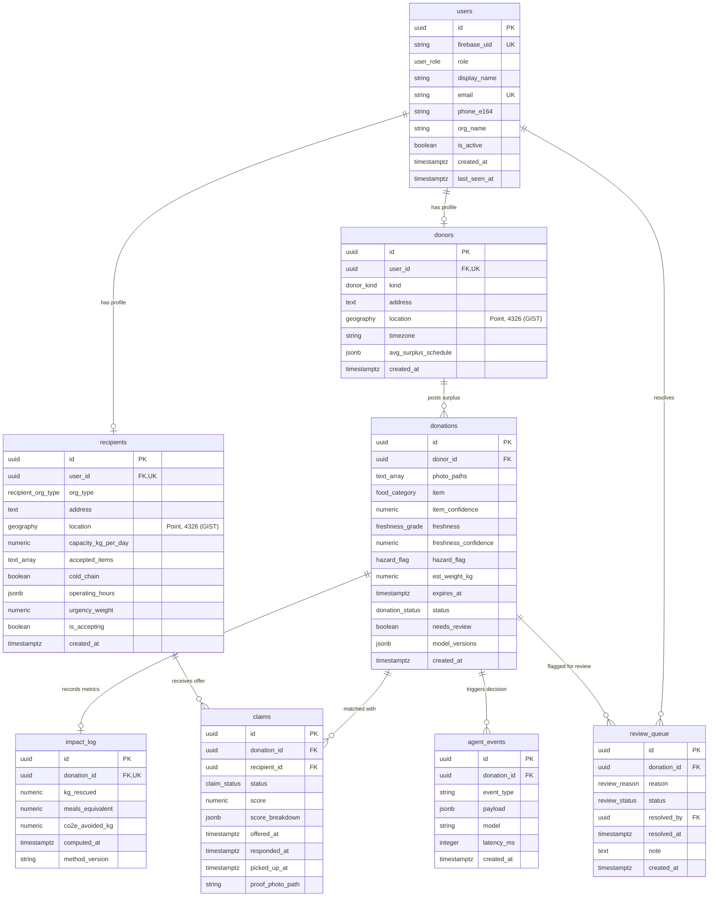

# BountyLoop — Database Schema & PostGIS Architecture

## Overview

BountyLoop uses **PostgreSQL 16** with the **PostGIS 3.4** spatial extension to power real-time, hyperlocal food rescue and circular redistribution. All coordinates are stored in high-precision `geography(Point, 4326)` columns indexed with **GIST** spatial indexes for microsecond-range geodesic distance calculations on the WGS 84 ellipsoid.

---

## Entity-Relationship Diagram



---

## Canonical Enums

| Enum Type | Values | Purpose |
|---|---|---|
| `user_role` | `donor`, `recipient`, `admin`, `volunteer` | RBAC access levels for API & apps |
| `donor_kind` | `restaurant`, `grocery`, `farm`, `household`, `other` | Donor source classification |
| `recipient_org_type` | `food_bank`, `shelter`, `community_fridge`, `discount_buyer` | Organizational tier & capacity |
| `food_category` | `produce_fruit`, `produce_vegetable`, `bread_bakery`, `dairy`, `grains_staples`, `prepared_cooked`, `meat_fish`, `soup_stew`, `dessert_bakery_sweet`, `beverage`, `condiment_sauce`, `other_unclassified` | 12-category unified rescue taxonomy (§5.2 Head A) |
| `freshness_grade` | `fresh`, `spoiled`, `grade_0_spoiled`, `grade_1_poor`, `grade_2_good`, `grade_3_fresh` | Binary (v1) and 4-tier (v2) freshness rating (§5.2 Head B) |
| `hazard_flag` | `none`, `suspected_contamination_or_formalin` | Safety gate forcing human review (§5.2 Head C) |
| `donation_status` | `draft`, `open`, `matched`, `in_transit`, `completed`, `cancelled`, `expired` | Donation lifecycle state machine |
| `claim_status` | `offered`, `accepted`, `declined`, `picked_up`, `failed` | Match offer and collection lifecycle |
| `review_reason` | `low_confidence`, `hazard`, `ambiguous_match`, `other` | Human-in-the-loop triage trigger |
| `review_status` | `pending`, `resolved` | Operator adjudication status |

---

## Geospatial Implementation Details

### Coordinate System & Types
- **SRID:** `4326` (WGS 84 GPS coordinates).
- **Column Type:** `geography(Point, 4326)`.
- **Storage Convention:** WKT format `POINT(longitude latitude)` (e.g. `POINT(-97.7408 30.3045)` for Austin, TX).
- **Index:** `CREATE INDEX idx_<table_name>_location ON <table_name> USING gist (location);` enabled on both `donors` and `recipients`.

### Core Spatial Queries

#### 1. Geodesic Distance in Metres
```sql
SELECT
    d.address AS donor,
    r.address AS recipient,
    ST_Distance(d.location, r.location) AS distance_meters
FROM donors d, recipients r
LIMIT 5;
```

#### 2. Radius Search (e.g., Recipients within 15 km of a Donor)
```sql
SELECT
    r.id,
    r.address,
    ST_Distance(d.location, r.location) / 1000.0 AS distance_km
FROM recipients r, donors d
WHERE d.id = :donor_id
  AND ST_DWithin(r.location, d.location, 15000.0) -- 15,000 metres
  AND r.is_accepting = true
ORDER BY distance_km ASC;
```

---

## Seed Data Summary (Pilot City: Austin, TX)

- **Admin User:** `admin@bountyloop.org`
- **Donors (5):**
  1. Central Market North Lamar (Grocery) — `30.3045, -97.7408`
  2. Whole Foods Market Lamar Flagship (Grocery) — `30.2707, -97.7533`
  3. Easy Tiger Bake Shop East (Restaurant/Bakery) — `30.2635, -97.7275`
  4. Boggy Creek Urban Farm (Farm) — `30.2762, -97.7088`
  5. Tacodeli South Lamar (Restaurant) — `30.2370, -97.7852`
- **Recipients (8):**
  1. Central Texas Food Bank (Food Bank, 2500 kg/day) — `30.2085, -97.7171`
  2. Casa Marianella Shelter (Shelter, 350 kg/day) — `30.2755, -97.7011`
  3. Foundation Communities Pantry (Food Bank, 600 kg/day) — `30.2345, -97.7668`
  4. Caritas of Austin Downtown (Shelter, 450 kg/day) — `30.2687, -97.7380`
  5. Hope Food Pantry Austin (Food Bank, 500 kg/day) — `30.3030, -97.7285`
  6. Sunrise Homeless Navigation Hub (Shelter, 400 kg/day) — `30.2285, -97.7850`
  7. ATX Free Fridge East 12th (Community Fridge, 120 kg/day) — `30.2730, -97.7250`
  8. Community Discount Market Co-op (Discount Buyer, 800 kg/day) — `30.2780, -97.7090`
- **Sample Donations:**
  - Easy Tiger surplus bread (35.5 kg, completed pickup, impact logged: 42.6 meals, 88.8 kg CO2e avoided).
  - Central Market organic produce (78.0 kg, active open offer to Central Texas Food Bank).

---

## Migration and Seed CLI Commands

```bash
# Run latest migrations
make migrate       # or docker compose exec api alembic upgrade head

# Rollback one migration
make downgrade     # or docker compose exec api alembic downgrade -1

# Seed pilot data (idempotent)
make seed          # or docker compose exec api python scripts/seed.py
```
